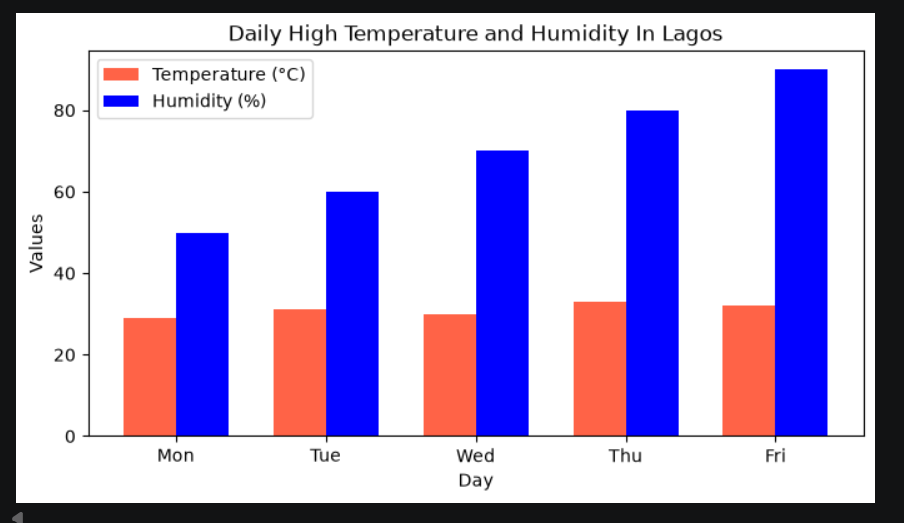
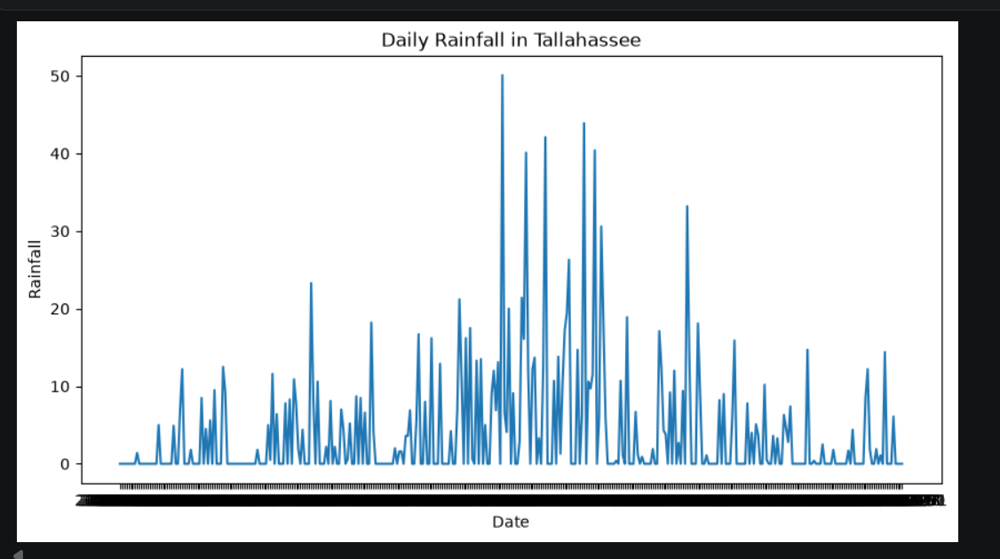

# Urban Climate and Meteorological Exploratory Data Analysis (EDA)

## 1. Project Title and Introduction
This repository contains an exploratory data analysis (EDA) project focused on analyzing meteorological and climate datasets for urban environments. Utilizing Python alongside data manipulation and visualization libraries, the project investigates daily high temperatures, humidity levels, and rainfall distributions to understand seasonal weather behaviors and microclimate variations across distinct geographic regions (specifically focusing on Lagos and Tallahassee).

---

## 2. Business and Analytical Problem
Understanding local weather variability is crucial for urban planning, infrastructure resilience, agricultural scheduling, and public health advisories. Raw meteorological data often contains noise, missing intervals, or complex multi-variable structures that obscure actionable insights. 

The core analytical challenge addressed in this project is: **How can historical daily weather observations be processed and visualized to accurately identify temperature-humidity trends and high-intensity rainfall events across different climate zones?**

---

## 3. Project Objectives and Analytical Questions
* **Temperature & Humidity Dynamics:** How do daily high temperatures correlate with humidity percentages across weekdays in Lagos?
* **Precipitation Tracking:** What are the temporal distribution patterns and peak intensities of daily rainfall in Tallahassee over the recorded period?
* **Data Inspection & Hygiene:** What structural constraints, missing values, or anomalies exist within raw CSV climate logs?

---

## 4. Dataset Description and Scope
* **Data Sources:** Structured CSV files containing daily weather logs, including `weather_2025.csv`.
* **Scope & Variables:** Daily chronological records featuring temporal fields (`date`, weekdays), thermal metrics (`temperature_c`), moisture metrics (`humidity_percent`), and precipitation metrics (`rainfall_mm`).
* **Data Classification:** Public/Sample observational meteorological records.
* **Limitations & Assumptions:** Analysis is constrained by the provided sample timeframes and presumes standardized sensor calibration across reporting stations.

---

## 5. Tools and Technologies
* **Python:** Core programming language used for script development and data processing.
* **Pandas:** Utilized for data ingestion (`pd.read_csv`), dataframe manipulation, and initial data inspection (`df.head()`).
* **Matplotlib:** Applied for programmatic generation of customized multi-metric bar charts and time-series line graphs (`plt.plot`, `plt.show`).
* **Jupyter Notebooks:** Interactive development environment for iterative data exploration and visualization prototyping.

---

## 6. Analytical Methodology and Workflow
1. **Environment Setup & Data Ingestion:** Loaded meteorological data into Pandas DataFrames from source CSV files.
2. **Data Inspection:** Executed initial exploratory checks (`df.head()`) to verify schema integrity, column naming conventions, and data types.
3. **Exploratory Data Analysis (EDA):** Grouped and aggregated thermal and moisture variables across chronological timelines (Monday through Friday).
4. **Data Visualization:** Developed dual-axis and grouped visualizations using Matplotlib to contrast temperature and humidity trends alongside continuous rainfall tracking.

---

## 7. Dashboard or Project Preview

### Lagos: Daily High Temperature vs. Humidity

*Figure 1: Grouped bar chart comparing daily high temperatures (°C, orange) against humidity percentages (%, blue) from Monday to Friday in Lagos.*

### Tallahassee: Daily Rainfall Distribution

*Figure 2: Time-series line plot illustrating daily rainfall fluctuations (mm) over the observation timeline in Tallahassee.*

---

## 8. Key Findings and Analytical Insights
* **Temperature Stability vs. Humidity Variance:** In the Lagos sample, daily high temperatures remained relatively stable across the work week (hovering near ~30–35°C), whereas humidity showed an upward trajectory peaking toward the end of the week (>80%).
* **Precipitation Spikes:** The Tallahassee rainfall analysis highlighted distinct storm surges with localized daily precipitation spikes exceeding 40–50 mm, interspersed with prolonged dry periods.

---

## 9. Business Implications and Recommendations
* **Infrastructure Readiness:** The identification of sharp precipitation peaks underscores the necessity for robust urban drainage maintenance during high-rainfall intervals.
* **Resource Planning:** Weather-dependent operational sectors (such as logistics and outdoor construction) can leverage these baseline EDA scripts to anticipate high-humidity or heavy-rain disruptions.

---

## 10. Repository Structure
```text
urban-climate-eda-python/
├── README.md
├── data/
│   ├── weather_2025.csv
│   └── rainfall_raw.csv
├── notebooks/
│   └── climate_eda_analysis.ipynb
└── images/
    ├── lagos-temp-humidity.png
    └── tallahassee-rainfall.png
